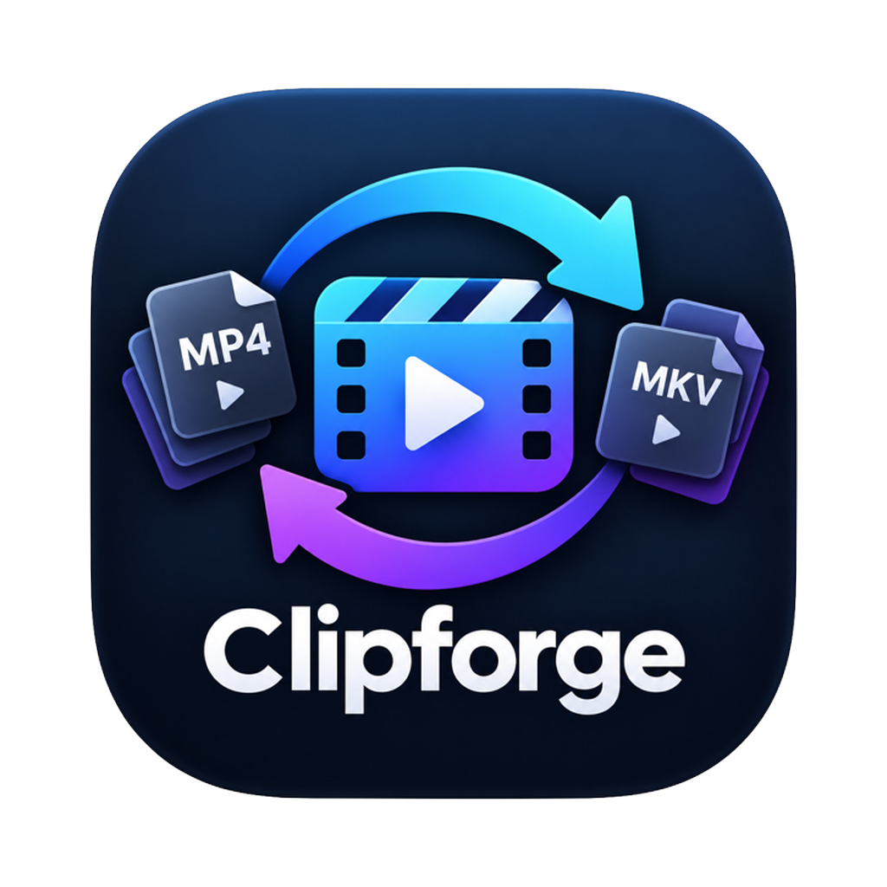
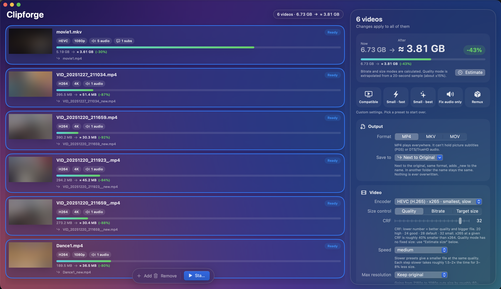
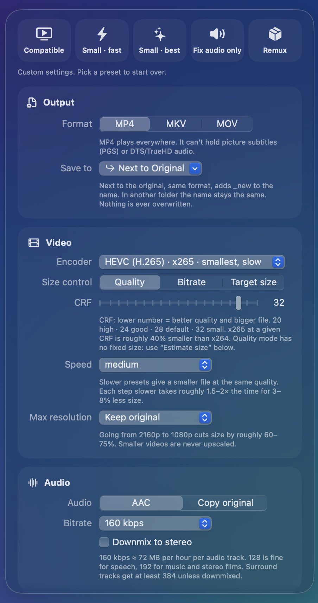
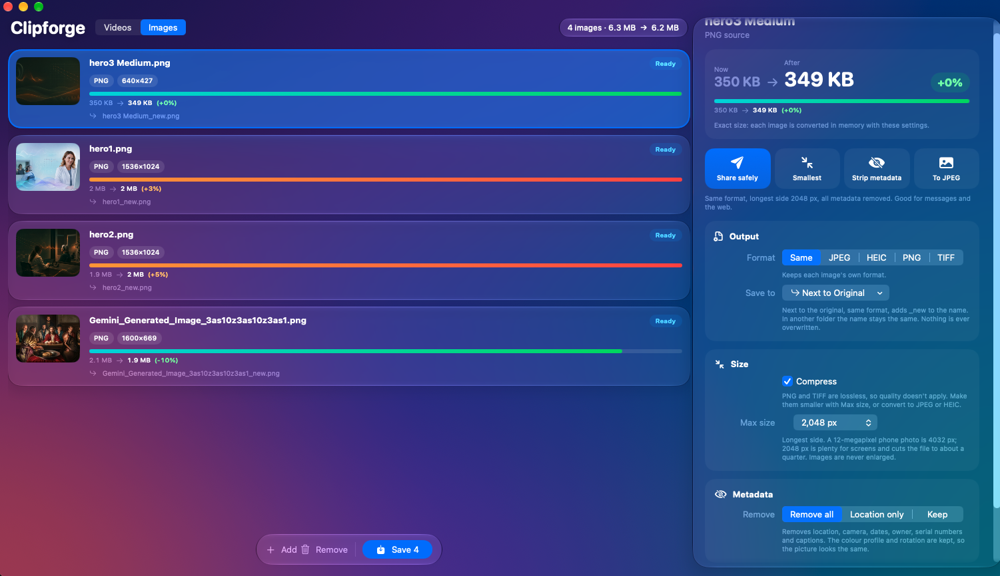

<p align="center">
  
</p>

<h1 align="center">Clipforge</h1>

<p align="center">
  Convert and shrink videos and images on your Mac, and strip the personal data out of photos.<br>
  Videos run through ffmpeg (built in); images use macOS's own image engine.
</p>

<p align="center">
  
</p>

## What it does

### Videos

- **Shrink files.** Re-encode to HEVC with Apple's hardware encoder (minutes) or x265 (smallest, slower).
- **Make files play everywhere.** H.264 + stereo AAC in MP4 for phones, TVs and browsers.
- **Fix audio only.** Keep the picture untouched and convert DTS/TrueHD to AAC.
- **Remux.** Change MKV ↔ MP4 ↔ MOV in seconds, with no quality loss.
- **Keep only the tracks you want.** Tick audio and subtitle tracks per file, or keep one language across a whole season.

### Images

- **Convert** between HEIC, JPEG, PNG and TIFF. Opens almost anything: also WebP, AVIF, GIF, BMP and camera RAW.
- **Shrink photos** with a quality setting and a maximum size. A 12-megapixel phone photo at 2048 px is about a quarter of the size.
- **Remove personal metadata**: location, camera, dates, owner name, serial number and captions. Or remove only the location.
- **No quality loss when only metadata changes.** JPEG, PNG and TIFF are copied untouched; just the metadata is rewritten.
- **See what's inside.** Photos with a location get an orange tag, and the panel lists everything stored in the file and what will be removed.

### Both

- **See the size before you start.** Every setting shows what it costs, and the panel shows *now → after*. For images the size is exact.
- **Save next to the original or to any folder.** Names stay the same (`movie.mkv` → `movie.mp4`, `IMG_0001.HEIC` → `IMG_0001.jpg`); `_new` is added only when the name is already taken. Nothing is ever overwritten.

<p align="center">
  
</p>

<!-- Screenshot: add docs/screenshots/images.png (the Images tab with a few photos), then remove this comment wrapper.
<p align="center">
  
</p>
-->

## Install

**Download:** from [Releases](../../releases), get the DMG for your Mac (Apple menu → **About This Mac**):

- **Chip: Apple M1, M2, M3, M4…** → `Clipforge-x.y.z-AppleSilicon.dmg`
- **Processor: Intel…** → `Clipforge-x.y.z-Intel.dmg`

Open it and drag **Clipforge** to Applications.

The first time you open it, macOS says it can't verify the app, because it isn't notarized by Apple. Click **Done**, then open **System Settings → Privacy & Security**, scroll down and click **Open Anyway**. You only do this once.

Or, after dragging it to Applications, run this once in Terminal instead:

```bash
xattr -dr com.apple.quarantine /Applications/Clipforge.app
```

This removes the "downloaded from the internet" flag that triggers the check.

**Build it yourself** (needs the Xcode Command Line Tools: `xcode-select --install`):

```bash
git clone <this repository>
cd Clipforge
./build.sh                      # downloads ffmpeg for your Mac's chip, builds build/Clipforge.app
open build/Clipforge.app
```

To use your own ffmpeg: `FFMPEG_DIR=/path/to/dir ./build.sh`. Homebrew's ffmpeg works on your Mac but not on others, and the script will warn you.

Requires macOS 13 or later. On macOS 26 it uses Liquid Glass; earlier versions get a frosted-glass look. Liquid Glass needs the app to be built with Xcode 26: the downloads are, but a build with older tools always gets the frosted look.

## Using it

Switch between **Videos** and **Images** at the top of the window. Each has its own queue and settings. Dropped files go to the right one automatically, and **⌘O** adds files to the one you're on.

### Videos

1. Drop videos on the window, or press **⌘O**.
2. Click a video to tune it. **⌘-click** or **⇧-click** to change several at once.
3. Pick a **preset**, then adjust anything you like. **Save to** (in Output) chooses next to the original or a folder of your choice; Clipforge remembers it.
4. **Tracks to keep:** tick the audio and subtitle tracks you want. With several videos selected, use the **Audio language / Subtitles** menus.
5. **Estimate** encodes 20 seconds and scales the result up. Bitrate and target-size modes are calculated instantly.
6. **Start** (⌘↩). Videos are encoded one at a time and your Mac won't idle-sleep. **Stop** (⌘.) deletes the half-written file.

Open **ffmpeg command** at the bottom of the panel to see and copy the exact command for a video.

### Images

1. Drop photos on the window, or press **⌘O** on the Images tab.
2. Click an image to tune it. **⌘-click** or **⇧-click** to change several at once.
3. Pick a **preset**, then adjust anything you like:

   | Preset | What it does |
   |---|---|
   | Share safely | Same format, longest side 2048 px, all metadata removed |
   | Smallest | HEIC at 1600 px, about a tenth of a phone photo |
   | Strip metadata | Removes location, camera and dates; JPEG/PNG/TIFF are copied untouched |
   | To JPEG | HEIC or PNG to JPEG, which opens everywhere; removes the location, keeps camera details |

4. **Format:** keep the same format, or convert to JPEG, HEIC, PNG or TIFF.
5. **Size:** **Compress** with a quality from 10 to 100 (JPEG and HEIC), and an optional **Max size** for the longest side. Images are never enlarged. Turn Compress off to keep the original compression.
6. **Metadata:** **Remove all**, **Location only**, or **Keep**. Select a single image to see what it contains, with a ✕ next to everything that will be removed.
7. **Save** (⌘↩). The *After* size shown before you save is the real size of the file you'll get.

When metadata is removed, the **rotation** and the **colour profile** are kept, so the picture looks exactly as before. The colour profile contains nothing personal.

## What the settings mean for size

### Videos

| Setting | Effect |
|---|---|
| HEVC vs H.264 | HEVC is ~40% smaller at the same quality. H.264 plays on everything. |
| Apple hardware vs x264/x265 | Hardware is 5–10× faster but ~10–20% bigger at equal quality. |
| CRF (x264/x265) | +6 ≈ half the size. 18 is near-transparent; 28 is visibly soft. |
| Max resolution | 4K → 1080p is roughly 60–75% smaller. |
| Audio bitrate | 192 kbps ≈ 86 MB per hour per track. |
| Dropping tracks | Extra audio languages are often 0.5–1.5 GB each on films. |

### Images

| Setting | Effect |
|---|---|
| HEIC vs JPEG | HEIC is about half the size at the same quality. JPEG opens everywhere. |
| Quality | 80 looks like the original to most people. Below 50, edges start to smear. |
| Max size | Halving the longest side cuts the file to roughly a quarter. |
| PNG / TIFF | Lossless and large for photos. Best for screenshots, graphics and editing. |
| Removing metadata | Usually saves only a few KB; it's about privacy, not size. |

## Known limits

### Videos

- **H.264 can make files bigger.** Re-encoding an x265 source with x264 often grows the file. Use an HEVC preset to shrink.
- **Picture subtitles (PGS/VobSub) can't go into MP4/MOV.** They're left out with a warning. Use MKV to keep them.
- **HDR → H.264 looks washed out** (warned). HEVC keeps 10-bit, but HDR metadata isn't guaranteed.
- **Target size is single-pass.** Expect ±5% on films and more on very short clips.
- **VideoToolbox "Quality" mode needs Apple Silicon.** On Intel, use Bitrate mode with the hardware encoders.

### Images

- **Output formats are JPEG, HEIC, PNG and TIFF.** WebP, AVIF, GIF and RAW can be opened but not saved; macOS can't write them.
- **Removing metadata from HEIC re-saves the picture** at high quality. Only JPEG, PNG and TIFF can be copied untouched.
- **Animated GIFs and multi-image files keep only their first frame** (warned).
- **JPEG has no transparency.** Transparent areas of PNGs become white (warned).
- **HDR photos may lose their extra brightness** when converted or resized. Check one before converting a whole library.
- **Live Photos** keep only the still image; the video part is a separate file Clipforge doesn't touch.

## Development

```bash
brew install ffmpeg   # the video integration tests encode real clips
swift test            # unit + integration tests for videos and images
swift run Clipforge   # run against Homebrew's ffmpeg
```

Every push builds the app and runs the tests in GitHub Actions on macOS 26 (Xcode 26, the Liquid Glass build) and, when GitHub has a machine free, on macOS 15 (Xcode 16, the frosted fallback). It also builds both DMGs as a dry run.
See [CONTRIBUTING.md](CONTRIBUTING.md) for the code layout and how releases work.

## License

Clipforge is free software under the [GNU GPL v3.0](LICENSE).
The app bundles [FFmpeg](https://ffmpeg.org), which is also GPL-licensed. See [THIRD_PARTY_NOTICES.md](THIRD_PARTY_NOTICES.md), including what to do if you redistribute the app.
Image conversion uses Apple's ImageIO, which is part of macOS and isn't bundled.
