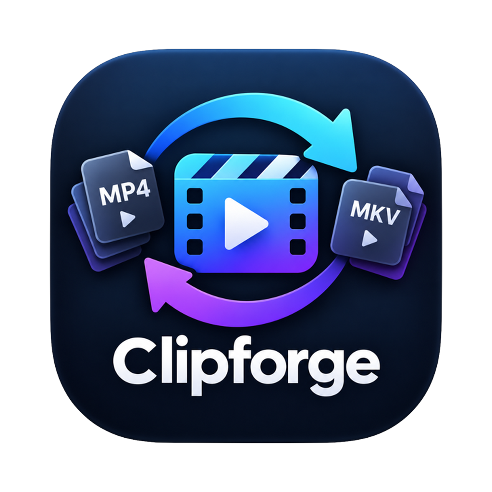
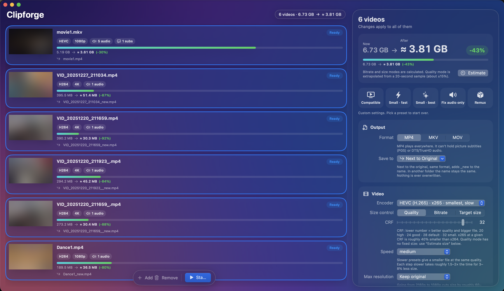
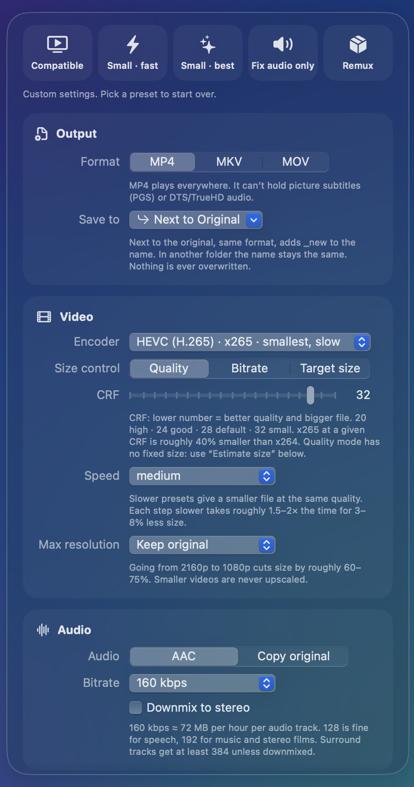

<p align="center">
  
</p>

<h1 align="center">Clipforge</h1>

<p align="center">
  Convert and shrink videos on your Mac. A friendly front end for ffmpeg, with ffmpeg built in.
</p>

<p align="center">
  
</p>

## What it does

- **Shrink files.** Re-encode to HEVC with Apple's hardware encoder (minutes) or x265 (smallest, slower).
- **Make files play everywhere.** H.264 + stereo AAC in MP4 for phones, TVs and browsers.
- **Fix audio only.** Keep the picture untouched and convert DTS/TrueHD to AAC.
- **Remux.** Change MKV ↔ MP4 ↔ MOV in seconds, with no quality loss.
- **Keep only the tracks you want.** Tick audio and subtitle tracks per file, or keep one language across a whole season.
- **See the size before you start.** Every setting shows what it costs, and the panel shows *now → after*.
- **Save next to the original or to any folder.** Names stay the same (`movie.mkv` → `movie.mp4`); `_new` is added only when the name is already taken. Nothing is ever overwritten.

<p align="center">
  
</p>

## Install

**Download:** from [Releases](../../releases), get the DMG for your Mac (Apple menu → **About This Mac**):

- **Chip: Apple M1, M2, M3, M4…** → `Clipforge-x.y.z-AppleSilicon.dmg`
- **Processor: Intel…** → `Clipforge-x.y.z-Intel.dmg`

Open it and drag **Clipforge** to Applications.

The first time you open it, macOS says it can't verify the app, because it isn't notarized by Apple. Click **Done**, then open **System Settings → Privacy & Security**, scroll down and click **Open Anyway**. You only do this once.

Or, after dragging it to Applications, run this once in Terminal instead:

```bash
xattr -dr com.apple.quarantine /Applications/Clipforge.app
```

This removes the "downloaded from the internet" flag that triggers the check.

**Build it yourself** (needs the Xcode Command Line Tools: `xcode-select --install`):

```bash
git clone <this repository>
cd Clipforge
./build.sh                      # downloads ffmpeg for your Mac's chip, builds build/Clipforge.app
open build/Clipforge.app
```

To use your own ffmpeg: `FFMPEG_DIR=/path/to/dir ./build.sh`. Homebrew's ffmpeg works on your Mac but not on others, and the script will warn you.

Requires macOS 13 or later. On macOS 26 it uses Liquid Glass; earlier versions get a frosted-glass look.

## Using it

1. Drop videos on the window, or press **⌘O**.
2. Click a video to tune it. **⌘-click** or **⇧-click** to change several at once.
3. Pick a **preset**, then adjust anything you like. **Save to** (in Output) chooses next to the original or a folder of your choice; Clipforge remembers it.
4. **Tracks to keep:** tick the audio and subtitle tracks you want. With several videos selected, use the **Audio language / Subtitles** menus.
5. **Estimate** encodes 20 seconds and scales the result up. Bitrate and target-size modes are calculated instantly.
6. **Start** (⌘↩). Videos are encoded one at a time and your Mac won't idle-sleep. **Stop** (⌘.) deletes the half-written file.

Open **ffmpeg command** at the bottom of the panel to see and copy the exact command for a video.

## What the settings mean for size

| Setting | Effect |
|---|---|
| HEVC vs H.264 | HEVC is ~40% smaller at the same quality. H.264 plays on everything. |
| Apple hardware vs x264/x265 | Hardware is 5–10× faster but ~10–20% bigger at equal quality. |
| CRF (x264/x265) | +6 ≈ half the size. 18 is near-transparent; 28 is visibly soft. |
| Max resolution | 4K → 1080p is roughly 60–75% smaller. |
| Audio bitrate | 192 kbps ≈ 86 MB per hour per track. |
| Dropping tracks | Extra audio languages are often 0.5–1.5 GB each on films. |

## Known limits

- **H.264 can make files bigger.** Re-encoding an x265 source with x264 often grows the file. Use an HEVC preset to shrink.
- **Picture subtitles (PGS/VobSub) can't go into MP4/MOV.** They're left out with a warning. Use MKV to keep them.
- **HDR → H.264 looks washed out** (warned). HEVC keeps 10-bit, but HDR metadata isn't guaranteed.
- **Target size is single-pass.** Expect ±5% on films and more on very short clips.
- **VideoToolbox "Quality" mode needs Apple Silicon.** On Intel, use Bitrate mode with the hardware encoders.

## Development

```bash
brew install ffmpeg   # the integration tests encode real clips
swift test            # unit + integration tests
swift run Clipforge   # run against Homebrew's ffmpeg
```

Every push runs the build and the tests on macOS 15 (Xcode 16) and macOS 26 (Xcode 26) in GitHub Actions, and packages the app.
See [CONTRIBUTING.md](CONTRIBUTING.md) for the code layout.

## License

Clipforge is free software under the [GNU GPL v3.0](LICENSE).
The app bundles [FFmpeg](https://ffmpeg.org), which is also GPL-licensed. See [THIRD_PARTY_NOTICES.md](THIRD_PARTY_NOTICES.md), including what to do if you redistribute the app.
